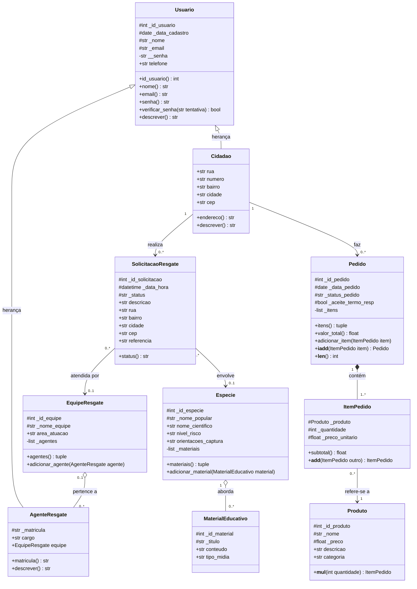

# Diagrama de Classes UML

O diagrama abaixo está em Mermaid e **aparece desenhado automaticamente no GitHub**.

Legenda de visibilidade: `+` público, `#` protegido (`_atributo`), `-` privado (`__atributo`).

## Observações
- **Herança:** `Cidadao` e `AgenteResgate` especializam `Usuario`.
- **Agregação** (losango vazado): uma equipe agrega agentes, que existem independentemente dela.
- **Composição** (losango cheio): os itens só existem dentro de um pedido.
- As multiplicidades seguem os comentários do código (`# realiza (1,1)`, `# atende (0,1)` etc.).
- A multiplicidade entre `Especie` e `MaterialEducativo` é uma suposição (o código só guarda a lista dentro da espécie).
